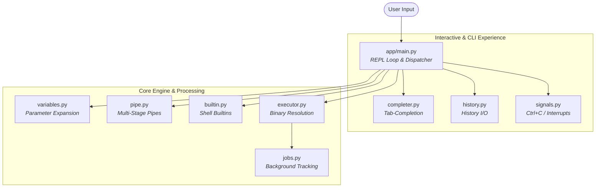

# flyx-shell

A modular Unix shell implemented in Python. It provides a POSIX-inspired command-line environment supporting built-in commands, multi-stage pipelines, I/O redirection, background job tracking, parameter expansion, and interactive tab-completion.

---

## System Architecture

The shell is built around a Read-Eval-Print Loop (REPL) that delegates parsing, expansion, and process control to discrete modules.



## Features

- Built-in Commands: Native implementations for cd, pwd, echo, type, history, declare, jobs, and kill.

- Pipeline Execution ( | ): Multi-stage pipelines managed via Unix file descriptors (os.pipe), file descriptor duplication (os.dup2), and process forking.

- I/O Redirection: Standard output (>, >>) and standard error (2>, 2>>) redirection.

- Parameter Expansion: Expansion of environment and local variables ($ VAR, ${ VAR }) across command arguments and file paths.

- Process & Job Control: Background execution (&), process group tracking, and non-blocking process reaping to handle exited child processes.

- Interactive Shell Features: GNU Readline integration featuring persistent session history stored in ~/.shell_history and tab-completion for builtins, system binaries, and paths.

## Quickstart

**This project uses uv for environment management and packaging.*

### Prerequisites

- Python 3.14+
-  uv installed on your system

### Installation & Execution

1- **Clone the repository:**
```
git clone https://github.com/Ali-Adel21/flux_shell.git
cd flux-shell
```

2- **Sync the environment:**
```
uv sync
```

3- **Launch the shell:**
```
uv run flux-shell
```